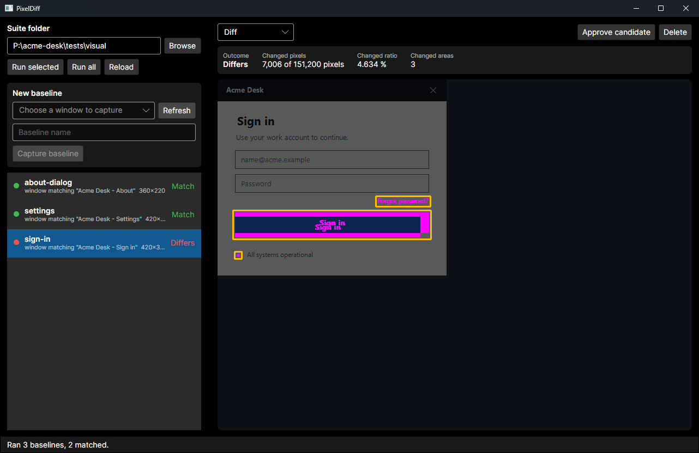
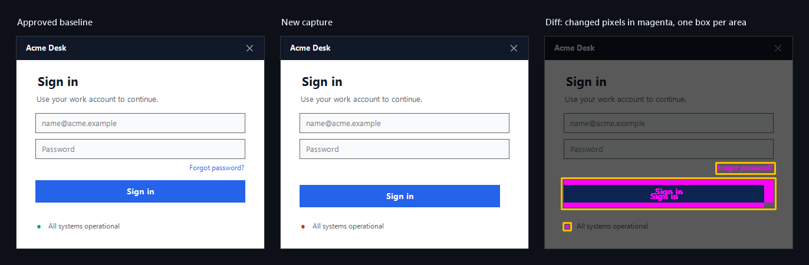

# PixelDiff

[](https://github.com/r00tmebaby/PixelDiff/releases/latest)
[](https://github.com/r00tmebaby/PixelDiff/releases)
[](LICENSE)


Visual regression testing for Windows desktop applications. Capture a window once, approve the image as the baseline, and fail the build when a later capture looks different.



PixelDiff is meant for people testing the look of a desktop application, a web page in a browser window or a dialog. There are two executables built from the same libraries: a desktop application for capturing, reviewing and approving baselines, and a command line runner (`pixeldiff`) for unattended runs on a build server.

## Why use it

- **It tests the real window.** Anything with a top level window can be a target: a native application, a dialog, or a browser showing a web page. Windows are rendered with `PrintWindow`, so a target can sit behind other windows while it is captured.
- **Baselines live in your repository.** A baseline is a PNG plus a small JSON file. An approved visual change appears in a pull request as a changed image, reviewed like any code change.
- **It can fail a build.** `pixeldiff run` recaptures every baseline, writes a report with the new capture and a diff image for each one that changed, and returns exit code 1.
- **Colour changes are not missed.** Pixels are compared by their largest channel difference instead of in grayscale, so a red status badge turning green is caught even when the brightness barely moves.
- **Unstable content can be excluded.** Each baseline has its own tolerance, allowed changed ratio and ignore regions for things like a clock or a build number.

## What a failure looks like

Here one window of a demo application changed between two builds: a link disappeared, the button moved and shrank, and the status dot changed colour.



The same suite run from a terminal:

```
> pixeldiff run --suite tests\visual
PASS about-dialog: match
PASS settings: match
FAIL sign-in: 7006 of 151200 pixels changed in 3 area(s)
2 of 3 matched, 1 failed. Report: P:\acme-desk\tests\visual\runs\20261120-235342\report.json
```

The run ends with exit code 1, which is what fails the build. The run directory holds `report.json` plus the new capture and the diff image of every baseline that did not match.

## Quick start

1. Download the two zip files from the [latest release](https://github.com/r00tmebaby/PixelDiff/releases/latest) and extract each into its own folder. `PixelDiff-<version>-win-x64.zip` is the desktop application and `pixeldiff-cli-<version>-win-x64.zip` is the command line runner. Both are self contained builds for 64 bit Windows, so no .NET installation is needed. They are not code signed, so Windows may ask for confirmation the first time you start them.
2. Open the application you want to test, then start `PixelDiff.exe`. It opens the suite at `Documents\PixelDiffSuite`; use **Browse** to choose another folder, ideally one inside your repository.
3. Pick the window from the list, enter a baseline name and choose **Capture baseline**.
4. After changing your application, choose **Run all**. On a build server, or from a terminal, run the same suite with:

   ```
   pixeldiff run --suite path\to\suite
   ```

5. Review each difference by switching the viewer between the baseline, the latest capture and the diff. If the change is intended, choose **Approve candidate** and commit the new baseline. If it is not, fix the application and run again.

To build from source instead, see [CONTRIBUTING.md](CONTRIBUTING.md).

## On a build server

The runner needs an interactive Windows desktop session with the target application open and visible, because it captures what is on screen. A minimal pipeline step:

```
pixeldiff.exe run --suite tests\visual --output build\visual
set code=%ERRORLEVEL%
if %code%==1 echo Visual changes detected. See build\visual for diffs.
exit /b %code%
```

| Exit code | Meaning |
| --- | --- |
| 0 | Every comparison matched. |
| 1 | At least one comparison did not match. |
| 2 | The arguments were wrong or incomplete. |
| 3 | The command failed before it could run, or the only failures were baselines that could not be captured or read. |

Publish the output directory as a build artifact whether or not the step passes. The commands, options, report format and exit codes are described in full in [Command line and continuous integration](docs/cli.md).

## Documentation

- [Using the desktop app](docs/workflow.md)
- [Command line and continuous integration](docs/cli.md)
- [How comparison works](docs/comparison.md), including how to tune a flaky baseline
- [How a baseline is stored](docs/baselines.md)
- [Limitations](docs/limitations.md)
- [Contributing](CONTRIBUTING.md): requirements, building, tests and project layout

## Limitations

The ones most likely to matter are below. The full list is in [docs/limitations.md](docs/limitations.md).

- Windows only. Capture uses GDI and DWM.
- The target window has to be open and not minimised, and the runner needs an interactive desktop session.
- Comparison is exact pixel arithmetic for deterministic interface rendering. It is not suited to video, animation or photographs.
- A capture and its baseline must be the same size, so capture and run on machines with the same display scaling and resolution.
- Tolerances, ignore regions and notes are edited in the JSON descriptor. The desktop application has no editor for them.

## Licence

PixelDiff is released under the [MIT licence](LICENSE).
